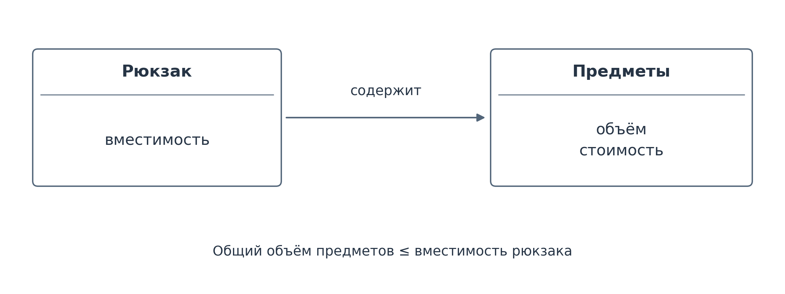
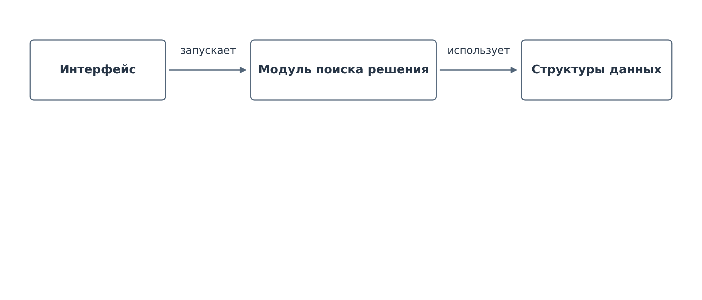

# Дизайн системы

## 1. Постановка задачи

Система должна находить набор из предметов с максимальной суммарной стоимостью при фиксированной вместимости рюкзака. Каждый предмет можно взять не более одного раза.

Программа может применяться для подбора вещей или товаров, которые нужно разместить в ограниченном объёме.
Например в экономике: выбор портфеля ценных бумаг, когда общий бюджет ограничен, а каждый проект дает разную прибыль и имеет разный риск.

## 2. Сущности задачи

**Предмет** — объект с определенными объёмом и стоимостью.

**Рюкзак** — имеет ограниченную вместимость.

Общий объём предметов в варианте не должен превышать вместимость рюкзака.

## 3. Архитектура                

### 3.1 Набор компонентов
**Интерфейс** принимает данные и показывает результат и ход поиска.

**Модуль поискап решения** находит оптимальный набор одним из двух методов.

**Структуры данных** хранят предметы и состояния, необходимые для поиска.
                                  
### 3.2 Схема связи

### 3.3 Описание структур и алгоритмов
#### Структуры
  - **Динамический массив** — для предметов и результата: количество предметов задаётся пользователем, а доступ к ним нужен по индексу.
  - **Дерево решений** — Выбрано потому что позволяет перебрать все варианты заполнения рюкзака. для вариантов «взять» и «пропустить». Связь состояния с предыдущим решением позволит восстановить выбранный набор.
  - **Очередь с приоритетами** — для выбора следующего состояния по верхней оценке возможной стоимости. Она должна быть построена на AVL-дереве, чтобы быстро добавлять и извлекать состояния.
  - **Хеш-таблица** — для хранения лучшей найденной стоимости по паре «следующий предмет — занятый объём». При одинаковой паре состояние с меньшей или равной стоимостью можно отбросить: оставшиеся предметы и свободное место совпадают. Коллизии должны разрешаться методом цепочек.

[//]: # (#### Алгоритмы)
[//]: # (- **Алгоритм заполнения рюкзака** - алгоритм ищущий такое наполнение рюкзака, что суммарная стоимость предметов была максимальной, а суммарный объем – не превосходил заданной величины)

## 4. Функциональные требования

### Предмет должен позволять:

- Задавать, просматривать и изменять объём и стоимость.

### Рюкзак должен позволять:

- Задавать, просматривать и изменять вместимость; не допускать отрицательную вместимость.
- Добавлять каждый предмет, не превышая вместимость рюкзака.
- Получать выбранные предметы, их общий объём и стоимость.

### Система должна позволять:

1. Вводить предметы и вместимость вручную или генерировать предметы с заданными параметрами; просматривать и редактировать исходные данные.
2. Проверять корректность ввода: объём и вместимость должны быть неотрицательными целыми числами, стоимость — целым числом. При ошибке должно выводиться сообщение.
3. Получать один оптимальный набор, его общую стоимость и объём.
4. Собирать рюкзак вручную с проверкой вместимости и просматривать записанные шаги поиска.
5. Проверять массив, AVL-дерево, хеш-таблицу, очередь с приоритетами и кучу по шагам, сравнивая ожидаемый и фактический результаты. Для шаблонных структур должны поддерживаться целые и вещественные числа и строки, для кучи — вещественные числа.

plantUML